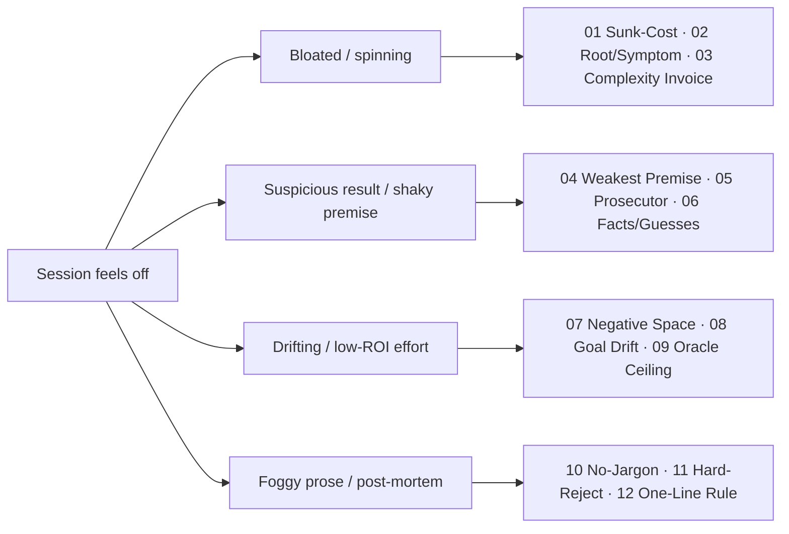

<a id="top"></a>

<div align="center">

# What Prompt Do You Need?

**12 High-Leverage Meta-Cognitive Prompts**  
One-sentence interventions to break AI coding & research agents out of tunnel vision, patch-stacking, sycophancy, and false confidence.

[简体中文](README.md) · **English**

[I. Cut Losses & Simplify](#part-1) · [II. Truth & Falsification](#part-2) · [III. Guardrails & Blind Spots](#part-3) · [IV. Clarity & Compounding](#part-4)

</div>

---

## Why Short Prompts Work Best

Long system instructions set baseline rules, yet in extended sessions agents still drift toward incremental patching, protecting their own prior code, agreeing with you, or hiding gaps behind jargon.

Each prompt below is **1–2 sentences** and completely domain-agnostic. Instead of telling the agent *how* to edit code, it flips the agent's *cognitive mode*—from defending a solution to prosecuting it, from adding complexity to pruning it.

> Every prompt lives in its own code block for one-click copy on GitHub.

---

## Quick Symptom Index

| When you sense that… | Use this prompt | Blind spot neutralized |
| :--- | :--- | :--- |
| Code and plans keep growing heavier; nothing gets deleted | [**01 · Sunk-Cost Reset**](#p01) | Attachment to prior patches |
| Several fixes in a row only move the failure around | [**02 · Root Cause vs. Symptom**](#p02) | Guardrails masking an upstream bug |
| Flags, thresholds, and special cases are multiplying | [**03 · Complexity Invoice**](#p03) | Over-engineering & magic numbers |
| The logic sounds smooth, but the foundation feels shaky | [**04 · Weakest Premise First**](#p04) | Unverified critical assumptions |
| Tests went all-green or metrics jumped suspiciously fast | [**05 · Prosecutor Mode**](#p05) | False positives, leakage & silent fallback |
| The proposal sounds confident, yet provenance is unclear | [**06 · Facts vs. Guesses Split**](#p06) | Hallucinated assumptions & stale docs |
| Something important feels unexamined before wrapping up | [**07 · Negative-Space Audit**](#p07) | Tunnel vision & cherry-picking |
| A long session drifted away from what you actually wanted | [**08 · Original-Goal Drift Check**](#p08) | Silent requirement downgrading |
| Heavy effort is going into a component with tiny impact | [**09 · Oracle Upper-Bound Test**](#p09) | Micro-optimizing a low-ceiling bottleneck |
| Answers are packed with acronyms yet feel hollow | [**10 · No-Jargon Mirror**](#p10) | Rhetoric disguising unclear thinking |
| Feedback feels polite and avoids the hard flaws | [**11 · Hard-Reject Reviewer**](#p11) | Sycophancy & soft criticism |
| A costly mistake just happened and must never recur | [**12 · Unbypassable One-Line Rule**](#p12) | Bloated rule docs nobody follows |



---

<a id="part-1"></a>

## I. Cut Losses & Simplify

<a id="p01"></a>

### 01 · Sunk-Cost Reset

> **Trigger**: After multiple rounds of iteration, the design feels bloated and the agent only proposes additive edits.

```text
Pretend you just inherited this project today and none of the existing code or plans count as sunk cost. If you had authority to delete 50% of it, which half would you cut and why?
```

- **Why it works**: Explicit permission to delete breaks the agent's default bias toward preserving everything it just wrote.

<a id="p02"></a>

### 02 · Root Cause vs. Symptom

> **Trigger**: Consecutive fixes keep adding guards, filters, or special cases without stabilizing the system.

```text
Split our recent changes into two columns: "root-cause fixes" and "symptom suppressors (patches, guards, special cases)." If we reverted the entire second column, what single upstream defect would surface?
```

- **Why it works**: Strips away layered workarounds to expose the one upstream flaw worth fixing properly.

<a id="p03"></a>

### 03 · Complexity Invoice

> **Trigger**: New switches, heuristic thresholds, or extra layers keep creeping into the design.

```text
Write a "complexity invoice" for every component, switch, and constant in the current design: what exact failure counterexample happens if we remove it? Delete anything that cannot name a concrete counterexample.
```

- **Why it works**: Reverses the burden of proof—every bit of complexity must earn its keep with a concrete counterexample.

---

<a id="part-2"></a>

## II. Truth & Falsification

<a id="p04"></a>

### 04 · Weakest Premise First

> **Trigger**: Final gate before committing to heavy implementation or long-running experiments.

```text
Break our current plan into 3–5 implicit premises that must all hold true. Rank them from most likely to be false to least, and design a minimal 10-minute test to falsify #1.
```

- **Why it works**: Attacks the weakest load-bearing assumption first before burning days downstream.

<a id="p05"></a>

### 05 · Prosecutor Mode (Assume the Good Result Is Fake)

> **Trigger**: Unexpectedly strong metrics, disappearing errors, or an effortlessly green test suite.

```text
Assume for now that this good result / all-green test is actually fake—caused by a bug, data leakage, mismatched evaluation, or silent fallback. Act as the prosecutor: list the 3 most plausible failure modes and verify each one against the evidence.
```

- **Why it works**: Asking "is this right?" invites self-defense; assigning the prosecutor role immediately unlocks adversarial verification.

<a id="p06"></a>

### 06 · Facts vs. Guesses Split

> **Trigger**: Rapid, confident diagnosis in an unfamiliar or complex codebase.

```text
Hold off on proposing a fix. First give me two separate lists: (1) hard facts you directly verified in live source code or logs, and (2) assumptions in your reasoning that came from guessing, intuition, or older docs.
```

- **Why it works**: Physically separates verified observations from unverified inference before any code gets touched.

---

<a id="part-3"></a>

## III. Guardrails & Blind Spots

<a id="p07"></a>

### 07 · Negative-Space Audit

> **Trigger**: Right before finalizing a conclusion, architecture decision, or benchmark report.

```text
Looking back over this entire investigation, what key branches, source files, metrics, or failing cases did we never open—yet if any of them contradicted us, our current conclusion would collapse?
```

- **Why it works**: Forces an explicit scan of the agent's blind spots—unchecked branches, ignored stderr, or omitted failure cases.

<a id="p08"></a>

### 08 · Original-Goal Drift Check

> **Trigger**: Mid-to-late stages of a long session when work feels subtly off-target.

```text
Put our very first goal from the start of this session side by side with the code or experiment you are working on right now: which core requirements were quietly downgraded, deferred, or redefined along the way?
```

- **Why it works**: Catches silent requirement substitution that accumulates across long multi-turn compromises.

<a id="p09"></a>

### 09 · Oracle Upper-Bound Test (Amdahl Stop-Loss)

> **Trigger**: Considering deep optimization or complex modeling for a single sub-component.

```text
Before writing any code: suppose this module magically became a perfect oracle tomorrow (zero runtime / 100% accuracy). How much better could the end-to-end system possibly get, and is that ceiling worth our effort?
```

- **Why it works**: A 30-second Amdahl's Law check that prevents polishing a bottleneck with negligible system-level headroom.

---

<a id="part-4"></a>

## IV. Clarity & Compounding

<a id="p10"></a>

### 10 · No-Jargon Mirror

> **Trigger**: Explanations or technical prose feel dense with acronyms and polished phrasing, yet unclear.

```text
Using zero acronyms, internal codenames, or marketing adjectives, explain in three plain sentences: what exact conflict are we stuck on, and what causal chain does our change actually alter?
```

- **Why it works**: Removes terminological camouflage so unclear thinking is immediately visible.

<a id="p11"></a>

### 11 · Hard-Reject Reviewer

> **Trigger**: Pre-submission paper review, research proposal vetting, or major design sign-off.

```text
Skip polite suggestions. Act as a strict reviewer determined to Strong Reject this work, and give the 3 hardest-to-rebut fatal objections—each anchored in a concrete gap in our actual data or mechanism.
```

- **Why it works**: Shuts down sycophancy while banning generic criticism, surfacing real high-severity weaknesses early.

<a id="p12"></a>

### 12 · Unbypassable One-Line Rule

> **Trigger**: Closing out a session right after surviving a painful or costly mistake.

```text
What was the single most expensive mistake we hit in this task? If we can only add one sentence to AGENTS.md so future-you can never bypass it again, how should that sentence be phrased?
```

- **Why it works**: Compresses post-mortems into sharp, enforceable guardrails instead of sprawling rules files nobody reads.

---

## How to Use

- **One at a time**: Firing a single targeted sentence works far better than stacking three prompts together.
- **Hide your bias**: Paste the prompt without telegraphing the answer you expect, then compare judgments.
- **Timing**: Use `04 / 06 / 09` before building, `01 / 02 / 03 / 08` mid-flight, and `05 / 07 / 11 / 12` before shipping.

<div align="right">

[↑ Back to top](#top)

</div>
