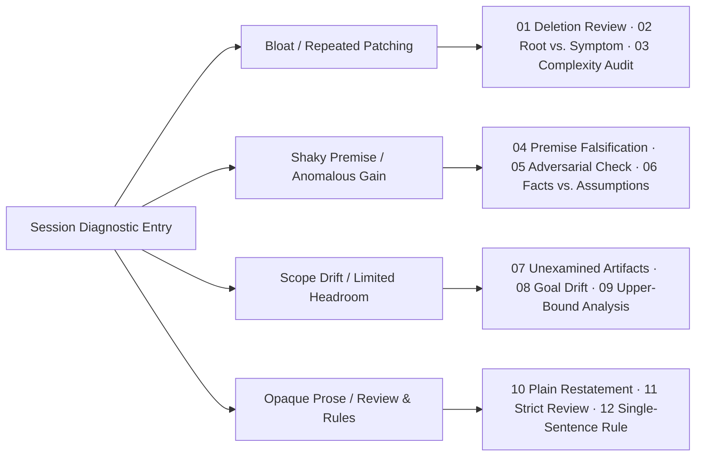

<a id="top"></a>

<div align="center">

# What Prompt Do You Need?

**12 Diagnostic & Meta-Review Prompts for Iterative Engineering and Research**  
Concise interventions for identifying path dependence, unverified assumptions, blind spots, and objective drift in multi-turn LLM sessions.

[简体中文](README.md) · **English**

[I. Complexity & Root-Cause Attribution](#part-1) · [II. Falsification & Verification](#part-2) · [III. Blind Spots & Scope Alignment](#part-3) · [IV. Clarity, Review & Rules](#part-4)

</div>

---

## Motivation

Static system instructions define baseline constraints, yet in extended engineering and research workflows language models still exhibit recurring failure modes: favoring additive patches over simplification, defending positive outcomes instead of auditing them, blending inference with verified evidence, and gradually drifting away from the initial objective.

The 12 prompts below are **1–2 sentence, domain-agnostic interventions**. Rather than prescribing implementation details, each prompt explicitly shifts the model's analytical stance (e.g., from code generation to falsification, deletion review, or boundary auditing).

> Each prompt is placed in a standalone code block for direct copy-and-paste reuse.

---

## Diagnostic Index

| Observed Pattern | Prompt | Target Failure Mode |
| :--- | :--- | :--- |
| Code and plans grow monotonically across turns without pruning | [**01 · Zero-Baseline Deletion Review**](#p01) | Path dependence and incremental bias |
| Repeated fixes add guards or special cases without resolving instability | [**02 · Root-Cause vs. Symptom-Suppression Split**](#p02) | Local workarounds masking upstream defects |
| Flags, heuristic thresholds, and special branches keep accumulating | [**03 · Counterexample-Backed Complexity Audit**](#p03) | Defensive over-engineering and ad hoc constants |
| Reasoning sounds coherent, yet foundational premises remain untested | [**04 · Implicit Premise Ranking & Minimal Falsification**](#p04) | Unverified load-bearing assumptions |
| Tests pass completely or metrics improve faster than expected | [**05 · Adversarial Verification of Positive Results**](#p05) | False positives, leakage, mismatched baselines, or silent fallback |
| Conclusions sound confident, but provenance is mixed | [**06 · Verified Facts vs. Unverified Assumptions**](#p06) | Conflating direct evidence with guesses or stale docs |
| Analysis appears complete, yet coverage gaps remain uncertain | [**07 · Unexamined-Artifact Audit**](#p07) | Sampling bias and selective attention |
| Mid-session implementation feels weaker than the original specification | [**08 · Initial-Objective Drift Comparison**](#p08) | Silent requirement downgrading over long context |
| Heavy effort is spent optimizing a single sub-component | [**09 · Idealized Upper-Bound Analysis**](#p09) | Diminishing returns on a low-ceiling bottleneck |
| Explanations rely heavily on acronyms and abstract phrasing | [**10 · Plain-Language Causal Restatement**](#p10) | Terminological obscurity masking unclear mechanics |
| Reviews remain overly polite and avoid substantive weaknesses | [**11 · Strict-Rejection Peer Review**](#p11) | Sycophancy and softened criticism |
| A costly error was resolved and must be prevented in future sessions | [**12 · Single-Sentence Regression Constraint**](#p12) | Sprawling instruction files that lose enforcement |



---

<a id="part-1"></a>

## I. Complexity Control & Root-Cause Attribution

Used to contain architectural bloat after multiple iterations and isolate upstream defects hidden beneath local workarounds.

<a id="p01"></a>

### 01 · Zero-Baseline Deletion Review

> **Context**: A codebase or design has accumulated complexity across rounds, while new proposals remain purely additive.

```text
Assume you are taking over this project today and none of the existing code or plans count as sunk cost. If you were permitted to delete 50% of the current implementation, which half would you remove first and why?
```

- **Mechanism**: Models treat prior artifacts in context as fixed commitments by default; explicitly authorizing deletion surfaces transitional scaffolding and redundant modules.

<a id="p02"></a>

### 02 · Root-Cause vs. Symptom-Suppression Split

> **Context**: Consecutive edits keep introducing guards, filters, or special cases without eliminating recurring failures.

```text
Classify our recent changes into two categories: "root-cause fixes" and "symptom suppressors (patches, guards, special cases)." If the entire second category were reverted, what single upstream defect would surface?
```

- **Mechanism**: Separates surface mitigations from structural changes so diagnosis converges on the underlying fault.

<a id="p03"></a>

### 03 · Counterexample-Backed Complexity Audit

> **Context**: Configuration flags, heuristic constants, or auxiliary abstractions accumulate without clear justification.

```text
Provide a necessity justification for every module, switch, and constant in the current design: what concrete failure counterexample occurs if it is removed? Remove any item that cannot cite a concrete counterexample.
```

- **Mechanism**: Shifts the burden of proof onto each unit of complexity by requiring a specific failure counterexample for retention.

---

<a id="part-2"></a>

## II. Assumption Falsification & Verification

Used to test load-bearing assumptions early and audit unexpectedly favorable outputs against primary evidence.

<a id="p04"></a>

### 04 · Implicit Premise Ranking & Minimal Falsification

> **Context**: Final checkpoint before committing to heavy implementation or long-running experiments.

```text
Decompose our current plan into 3–5 implicit premises that must simultaneously hold. Rank them from most likely to be false to least, and design a minimal test executable within 10 minutes to falsify the top-ranked premise.
```

- **Mechanism**: Makes hidden dependencies explicit and prioritizes cheap falsification of the weakest assumption before downstream investment.

<a id="p05"></a>

### 05 · Adversarial Verification of Positive Results

> **Context**: A test suite passes cleanly, a prior error disappears, or quantitative metrics improve beyond physical expectations.

```text
Assume provisionally that this positive result or passing test suite is invalid—due to a bug, data leakage, evaluation mismatch, or silent fallback. From an adversarial review stance, identify the 3 most plausible invalidation paths and check each one against the source code and logs.
```

- **Mechanism**: Neutral confirmation queries tend to elicit post-hoc rationalization; assigning an adversarial verification role encourages systematic checking of edge cases and evaluation parity.

<a id="p06"></a>

### 06 · Verified Facts vs. Unverified Assumptions

> **Context**: Debugging unfamiliar codebases or multi-module systems where confident claims require provenance checks.

```text
Before proposing a fix, provide two separate lists: (1) facts directly verified from live source code, logs, or measurements, and (2) assumptions in the preceding reasoning drawn from inference, convention, or unverified documentation.
```

- **Mechanism**: Establishes an explicit boundary between direct observations and inferred premises prior to editing code.

---

<a id="part-3"></a>

## III. Coverage Blind Spots & Scope Alignment

Used to audit omitted artifacts, detect gradual drift from initial goals, and estimate system-level headroom.

<a id="p07"></a>

### 07 · Unexamined-Artifact Audit

> **Context**: Prior to finalizing a diagnosis, technical report, or experimental conclusion.

```text
Reviewing this entire investigation, which critical branches, source files, evaluation metrics, or failing cases were never inspected, yet would invalidate our current conclusion if they behaved contrary to expectation?
```

- **Mechanism**: Prompts a systematic sweep of uninspected artifacts—such as unchecked branches, truncated stderr logs, or excluded failure cases.

<a id="p08"></a>

### 08 · Initial-Objective Drift Comparison

> **Context**: Mid-to-late turns of a long session where incremental compromises may have weakened core goals.

```text
Compare the original objective from the start of this session side by side with the code or experiment currently underway: which core requirements have been quietly downgraded, deferred, or redefined?
```

- **Mechanism**: Direct comparison between the initial prompt and current artifacts reveals silent scope dilution or substitution of approximations for core requirements.

<a id="p09"></a>

### 09 · Idealized Upper-Bound Analysis

> **Context**: Prior to investing in complex algorithmic or runtime optimization of an individual module.

```text
Before implementing changes, estimate an upper bound: if the target module reached an idealized limit (zero runtime overhead or 100% accuracy), what is the maximum possible improvement to the end-to-end system, and does that ceiling justify further effort?
```

- **Mechanism**: Applies an Amdahl's-law framing before implementation to bound end-to-end headroom and avoid low-yield optimization.

---

<a id="part-4"></a>

## IV. Clarity, Critical Review & Rule Distillation

Used to strip opaque terminology, obtain substantive technical criticism, and distill post-mortems into enforceable rules.

<a id="p10"></a>

### 10 · Plain-Language Causal Restatement

> **Context**: Technical explanations or drafts are dense with acronyms and abstract phrasing while the core mechanism remains unclear.

```text
Using no acronyms, internal codenames, or decorative modifiers, state in three plain sentences: what core conflict are we facing, and which exact causal chain does our change alter?
```

- **Mechanism**: Removing terminological abstraction exposes conceptual gaps and unsupported causal steps immediately.

<a id="p11"></a>

### 11 · Strict-Rejection Peer Review

> **Context**: Pre-submission manuscript review, research proposal vetting, or major design sign-off.

```text
Omit polite suggestions. Adopt the perspective of a strict reviewer inclined toward Strong Reject and list the 3 hardest-to-rebut technical objections, each anchored in a concrete gap in our current data, assumptions, or mechanism.
```

- **Mechanism**: Counteracts default agreeableness while constraining critiques to concrete evidence in the current artifact rather than generic remarks.

<a id="p12"></a>

### 12 · Single-Sentence Regression Constraint

> **Context**: Concluding a session after diagnosing a costly defect or avoidable rework.

```text
What was the highest-cost failure mode encountered in this task? If we can add only one sentence to AGENTS.md to prevent future sessions from repeating it, how should that constraint be stated so it is unambiguous and difficult to bypass?
```

- **Mechanism**: Compresses lessons learned into concise, checkable rules rather than growing verbose instruction files that degrade adherence.

---

## Usage Notes

- **One prompt per turn**: Applying a single targeted prompt yields deeper analysis than stacking multiple prompts at once.
- **Keep framing neutral**: Avoid hinting at the expected conclusion when issuing the prompt; compare independent judgments afterward.
- **Stage alignment**: Prompts `04 / 06 / 09` fit pre-implementation review, `01 / 02 / 03 / 08` fit mid-iteration correction, and `05 / 07 / 11 / 12` fit verification and post-mortem synthesis.

<div align="right">

[↑ Back to top](#top)

</div>
