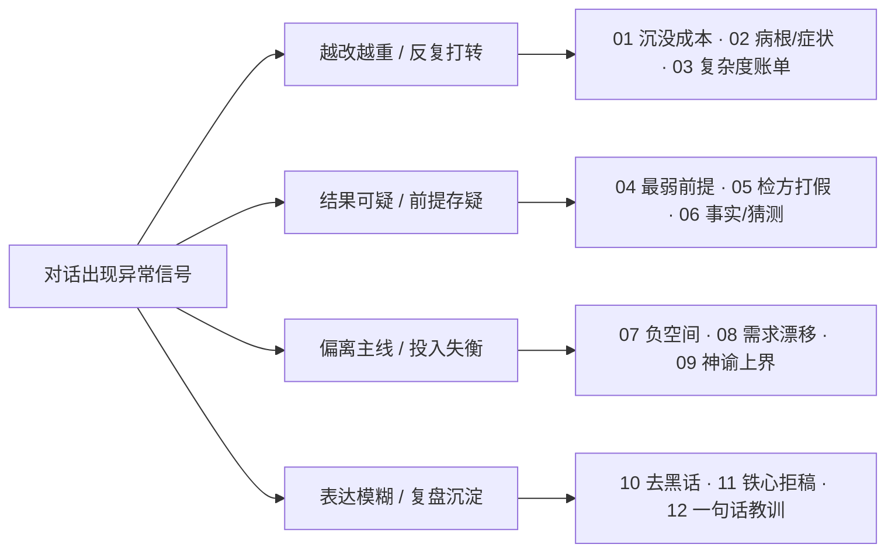

<a id="top"></a>

<div align="center">

# What Prompt Do You Need?

**12 句高杠杆「元认知手术刀」Prompt**  
在长对话陷入打转、过度设计、迎合或假成功时，用一句话扭转 Agent 的工作模式。

**简体中文** · [English](README.en.md)

[一、止损与去噪](#part-1) · [二、求真与证伪](#part-2) · [三、防偏航与反盲区](#part-3) · [四、穿透表达与复利沉淀](#part-4)

</div>

---

## 为什么需要这些短句

长篇系统提示词适合定规矩，但在多轮真实研发中，Agent 仍会滑向**局部补丁惯性、护短旧代码、顺着你说话、盲区漏检、拿术语糊弄**。

真正高杠杆的干预往往只有 **1～2 句话**——它们不教 Agent 具体怎么写代码，而是直接切换它的认知姿态：从「继续叠补丁」切到「清零审计」，从「替结果辩护」切到「检方打假」。

> 所有 Prompt 均放在独立代码块中，点击右上角即可一键复制。

---

## 按症状速查

| 你隐约感觉到…… | 立刻用这句 | 狙击的 Agent 盲区 |
| :--- | :--- | :--- |
| 代码和方案越改越重，Agent 舍不得删旧东西 | [**01 · 沉没成本清零**](#p01) | 增量修补惯性与护短心理 |
| 连着打了好几个补丁，问题却按下葫芦浮起瓢 | [**02 · 改病根 vs 压症状**](#p02) | 补丁掩盖上游核心缺陷 |
| 开关、参数和特判越加越多，系统开始失控 | [**03 · 复杂度账单**](#p03) | 防御性过度设计与魔数堆砌 |
| 逻辑看起来很顺，但隐约觉得地基可能站不住 | [**04 · 最弱前提单点爆破**](#p04) | 未验证的隐含关键假设 |
| 指标突然大涨或测试一片全绿，好得不太真实 | [**05 · 检方模式：假设结果是假的**](#p05) | 假绿、数据泄漏、口径错位与静默降级 |
| 方案写得头头是道，却分不清哪些是读过代码的 | [**06 · 事实 vs 猜测强制劈开**](#p06) | 脑补细节与默认过期文档 |
| 排查或实验总觉得漏掉了什么关键角落 | [**07 · 负空间审计**](#p07) | 隧道视野与只看有利样本 |
| 聊了很多轮，感觉离一开始要做的事越来越远 | [**08 · 原始需求漂移对照**](#p08) | 核心目标被悄悄降级或偷换 |
| 在某个局部优化上花了很多时间，收益却很小 | [**09 · 神谕上界测试**](#p09) | 在低天花板瓶颈上死磕微优化 |
| 回复满屏术语和缩写，越看越觉得它没想明白 | [**10 · 去黑话照妖镜**](#p10) | 用学术修辞掩饰逻辑空洞 |
| 请它审稿或评方案，它只给不痛不痒的客气话 | [**11 · 铁心拒稿审稿人**](#p11) | 温和迎合与避重就轻 |
| 刚踩完一个很贵的坑，不想下个会话再重演 | [**12 · 一句话不可绕过教训**](#p12) | 规则文档越写越长却没人遵守 |



---

<a id="part-1"></a>

## 一、止损与去噪

专治多轮迭代后的代码臃肿、补丁叠补丁与参数膨胀。

<a id="p01"></a>

### 01 · 沉没成本清零

> **适用信号**：重构或迭代数轮后结构变乱，Agent 仍倾向在旧代码上继续打补丁。

```text
假设你今天刚接手这个项目，前面写的代码和方案全都不算沉没成本——如果你有权删掉其中 50%，你会砍掉哪一半？为什么？
```

- **为什么有效**：模型对“自己刚写好的代码”有极强的保留惯性；显式授予「删除一半」的权限，能立刻逼出哪些模块本来就是过渡包袱。

<a id="p02"></a>

### 02 · 改病根 vs 压症状

> **适用信号**：连续几轮一直在修边界、加特判或补护栏，却始终无法根治异常。

```text
把我们过去几轮改动按“治病根”和“压症状（补丁/护栏/特判）”分成两栏——如果把“压症状”那栏全撤掉，系统到底暴露出哪个单一核心问题？
```

- **为什么有效**：强制做减法归因，把分散在各处的五六个零碎补丁还原回唯一值得动手术的上游根因。

<a id="p03"></a>

### 03 · 复杂度账单

> **适用信号**：方案中不断冒出新开关、经验常数、兜底分支或额外抽象层。

```text
给当前方案里的每个模块、开关和常数列一张“复杂度账单”：删掉它到底会触发什么具体反例？答不出具体反例的，一律删掉。
```

- **为什么有效**：比笼统地说「简化一下」硬十倍——它把举证责任倒置给复杂度本身，没有具体反例撑腰的设计直接出局。

---

<a id="part-2"></a>

## 二、求真与证伪

专治隐蔽前提崩塌、假成功与脑补混充事实。

<a id="p04"></a>

### 04 · 最弱前提单点爆破

> **适用信号**：准备投入大规模编码或长耗时实验前的最后一道闸门。

```text
把我们当前方案拆成 3～5 条必须同时成立的隐含前提，按“最可能其实是错的”从高到低排序，并给第 1 条设计一个 10 分钟内能证伪它的最小验证。
```

- **为什么有效**：先打最脆弱的那根柱子，用十分钟的低成本证伪避免一周的沉没投入。

<a id="p05"></a>

### 05 · 检方模式：假设好结果是假的

> **适用信号**：测试一片全绿、异常报错突然消失，或实验指标好得超出直觉。

```text
先假设现在这个好结果/全绿测试其实是假的（由 bug、数据泄漏、尺子错位或静默降级造成），请你当检方列出最可能的 3 种造假路径，并逐一查证排除。
```

- **为什么有效**：正面问「这个结果对不对」，模型大概率替自己辩护；反向设定「假设它是假的由你起诉」，瞬间切换至对抗审计模式。

<a id="p06"></a>

### 06 · 事实 vs 猜测强制劈开

> **适用信号**：排查复杂代码或跨仓库问题，Agent 迅速给出看似胸有成竹的结论。

```text
先别给方案，只列两张表：① 你亲眼读过源码/日志核实过的硬事实；② 你刚才的推理里其实靠猜、靠常识或默认旧文档成立的假设。
```

- **为什么有效**：在动笔改码前把「已核实证据」和「隐含脑补」物理劈开，绝大多数误判都在第二张表里直接现形。

---

<a id="part-3"></a>

## 三、防偏航与反盲区

专治视野隧道效应、需求暗度陈仓与低收益内卷。

<a id="p07"></a>

### 07 · 负空间审计（我们没看什么）

> **适用信号**：结论已经成形、准备收尾汇报或做架构拍板之前。

```text
回顾整轮排查和实验，有哪些关键分支、源码文件、指标或失败样本是我们自始至终没打开看过、但一旦看错就会推翻当前结论的？
```

- **为什么有效**：迫使模型扫描自己的注意力盲区，专门捕捉“漏看的分支”“没展开的 stderr”“没算进汇总的失败样本”。

<a id="p08"></a>

### 08 · 原始需求漂移对照

> **适用信号**：长对话进行到中后期，感觉实现越来越偏离最初设想。

```text
把我们这个会话最开始的原始目标，和你现在正在写的代码/跑的实验并排对比：哪些核心要求在迭代中被悄悄降级、搁置或偷换概念了？
```

- **为什么有效**：直接对抗长上下文中的“目标稀释”——防止核心需求在多轮折衷里被悄悄替换成退化近似。

<a id="p09"></a>

### 09 · 神谕上界测试（Amdahl 止损）

> **适用信号**：准备对某个子模块做重型加速或精细建模，但不确定全局收益天花板。

```text
先别写代码——假设我们要改的这个模块明天瞬间变成完美神谕（耗时为 0 / 精度 100%），整个端到端系统最多能好多少？上限值不值得我们继续花时间？
```

- **为什么有效**：Amdahl 定律的元认知版；30 秒算清理论天花板，避免在只占全局 5% 空间的瓶颈上精雕细琢。

---

<a id="part-4"></a>

## 四、穿透表达与复利沉淀

专治黑话糊弄、客套审稿与教训无法跨会话复用。

<a id="p10"></a>

### 10 · 去黑话照妖镜

> **适用信号**：技术方案、论文段落或报错解释堆满缩写与高深名词，读完依然抓不住重点。

```text
不许用任何缩写、内部代号和修饰词，用三句大白话讲清楚：这件事到底卡在哪个核心矛盾上，我们的改动到底改变了什么因果链？
```

- **为什么有效**：当模型自己没想透时，最擅长用专业术语织网遮丑；禁用黑话立刻照出究竟是真懂还是空转。

<a id="p11"></a>

### 11 · 铁心拒稿审稿人

> **适用信号**：论文投稿、课题立项或关键设计评审前需要最刺耳的真话。

```text
不要给温和建议——假装你是铁了心要 Strong Reject 的苛刻审稿人，写出最难反驳的 3 条致命拒稿理由，每条必须锚定我们现有数据或机制漏洞。
```

- **为什么有效**：彻底关闭礼貌缓冲，并且用「锚定现有数据或机制漏洞」封死空泛套话，提前暴露审稿人真正的必杀点。

<a id="p12"></a>

### 12 · 一句话不可绕过教训

> **适用信号**：刚解决一次昂贵的返工或隐蔽故障，准备收尾并更新项目规范。

```text
这轮任务里我们踩过最贵的一个坑是什么？如果只能用一句话写进 AGENTS.md 确保未来的你绝对绕不过去，这句话怎么写最狠？
```

- **为什么有效**：强迫把复盘压缩为单一刚性红线，防止 `AGENTS.md` / `CLAUDE.md` 沦为冗长无人读的备忘录。

---

## 使用节奏建议

- **一次只抛一句**：把三条混在一起发会稀释聚焦度；命中当下最痛的症状，单刀直入效果最好。
- **别自带答案**：发出去时不要顺带暗示你的倾向，先把判断空间留给对方，再交叉核验。
- **越早止损越省算力**：`04 / 06 / 09` 适合写第一行代码前，`01 / 02 / 03 / 08` 适合迭代中段，`05 / 07 / 11 / 12` 适合收口验收前。

<div align="right">

[↑ 返回顶部](#top)

</div>
