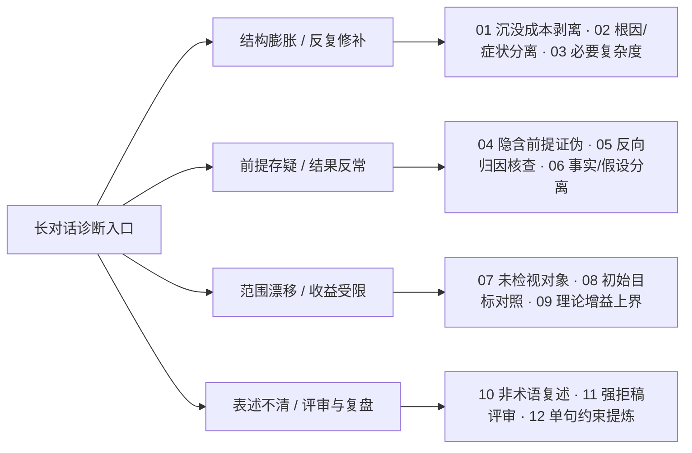

<a id="top"></a>

<div align="center">

# What Prompt Do You Need?

面向多轮代码与科研协作的 **12 条诊断与元审查提示词**  
用于识别并修正长对话中的路径依赖、隐含假设偏差、验证盲区与目标漂移。

**简体中文** · [English](README.en.md)

[一、复杂度控制与根因回溯](#part-1) · [二、前提证伪与结果核验](#part-2) · [三、覆盖盲区与目标对齐](#part-3) · [四、表述澄清、评审与规范固化](#part-4)

</div>

---

## 背景与动机

静态系统提示词用于约束常规行为边界，但在多轮迭代的代码实现与科研探索中，模型仍容易出现结构性偏差：倾向于增量修补而非重构、对正向实验结果缺乏反向核查、将未核实推断混入已知事实、在长上下文中逐渐偏离初始约束。

下文整理的 12 条提示词均为 **1–2 句、领域无关的短指令**。它们不指定具体实现步骤，而是用于显式切换模型的审查视角（例如由生成/辩护模式转为证伪/删减模式）。

> 每条提示词均置于独立代码块中，便于直接复制使用。

---

## 问题模式索引

| 观察到的现象 | 对应提示词 | 针对的失效模式 |
| :--- | :--- | :--- |
| 经过多轮修改后结构持续膨胀，但模型很少主动删减既有代码 | [**01 · 沉没成本剥离**](#p01) | 对既有实现的路径依赖与增量偏置 |
| 连续多次修复后异常仍反复出现，仅通过边界拦截维持运行 | [**02 · 根因修正与症状抑制分离**](#p02) | 局部补丁掩盖上游结构性缺陷 |
| 配置开关、经验常数与特判分支不断增加 | [**03 · 必要复杂度核查**](#p03) | 防御性过度设计与缺乏依据的超参累积 |
| 方案推理连贯，但底层前提尚未经过实证检验 | [**04 · 隐含前提排序与最小证伪**](#p04) | 未验证的关键假设导致后期返工 |
| 测试全部通过或指标显著改善，结果超出物理/工程预期 | [**05 · 反向归因核查**](#p05) | 假阳性、数据泄漏、评估口径失配或静默降级 |
| 分析结论表述确定，但难以区分哪些基于实测、哪些基于推断 | [**06 · 核实事实与未验证假设分离**](#p06) | 将经验推测或过期文档混充为直接证据 |
| 排查接近收尾，但尚不确定是否存在未覆盖的分支或异常样本 | [**07 · 未检视对象审查**](#p07) | 局部采样偏差与注意力盲区 |
| 多轮折衷之后，当前实现与最初定义的核心问题出现落差 | [**08 · 初始目标一致性对照**](#p08) | 长上下文下的需求降级与概念替换 |
| 在单一模块上持续投入优化，但端到端收益有限 | [**09 · 理论增益上界估算**](#p09) | 在低上界瓶颈上的边际投入失衡 |
| 技术说明充斥缩写与抽象修饰，核心因果关系不清晰 | [**10 · 非术语化因果复述**](#p10) | 术语堆砌掩盖机理理解不足 |
| 对方案或论文稿的审阅意见偏温和，未触及实质性弱点 | [**11 · 强拒稿视角评审**](#p11) | 迎合倾向与防御性弱化批评 |
| 刚刚定位并修复一次高成本错误，希望在后续会话中避免重演 | [**12 · 单句防复发约束提炼**](#p12) | 规范文档冗长、约束难以被稳定遵守 |



---

<a id="part-1"></a>

## 一、复杂度控制与根因回溯

用于在多轮迭代后收敛代码与设计复杂度，剥离掩盖上游缺陷的局部补丁。

<a id="p01"></a>

### 01 · 沉没成本剥离

> **适用场景**：方案或代码经历多轮迭代后日趋复杂，但后续改动始终停留在局部叠加。

```text
假设你今天刚接手这个项目，此前编写的代码和方案均不计为沉没成本。如果允许你删除其中 50% 的实现，你会优先移除哪一部分？请说明依据。
```

- **作用机制**：模型在连续上下文中默认将已有产出视为保留前提；显式解除保留约束后，能够识别出仅用于过渡的历史代码与冗余模块。

<a id="p02"></a>

### 02 · 根因修正与症状抑制分离

> **适用场景**：连续多轮排查均在增加特判、过滤条件或保护逻辑，但系统行为仍不稳定。

```text
请将过去几轮改动划分为“根因修正”与“症状抑制（补丁、护栏、特判）”两类。若将第二类改动全部撤回，系统会集中暴露出哪一个上游核心缺陷？
```

- **作用机制**：将分散的表层绕过逻辑剥离后重新归因，促使分析回到单一上游机制而非继续叠加局部约束。

<a id="p03"></a>

### 03 · 必要复杂度核查

> **适用场景**：方案中陆续引入多个配置开关、经验阈值或辅助分支，难以判断各自的必要性。

```text
请为当前方案中的每个模块、开关和常数列出必要性说明：移除该项后会触发哪一个具体的失败反例？无法给出具体反例的项，请直接移除。
```

- **作用机制**：相比宽泛的“请简化方案”，该约束将举证责任转移给每一项新增复杂度，以具体反例作为保留门槛。

---

<a id="part-2"></a>

## 二、前提证伪与结果核验

用于在重投入前识别脆弱假设，以及对异常良好的实验或测试结果进行反向审查。

<a id="p04"></a>

### 04 · 隐含前提排序与最小证伪

> **适用场景**：进入大规模编码或长耗时实验前的可行性复核。

```text
请将当前方案拆解为 3–5 条必须同时成立的隐含前提，按“最可能不成立”的顺序列出，并为排名第一的前提设计一个可在 10 分钟内完成证伪的最小实验。
```

- **作用机制**：将最脆弱的隐含条件显式化并前置验证，降低在错误假设上持续投入工程成本的风险。

<a id="p05"></a>

### 05 · 反向归因核查

> **适用场景**：测试全部通过、历史报错突然消失，或实验指标改善幅度明显超出预期。

```text
请先假定当前的正向结果或全绿测试是失真的（例如源于实现错误、数据泄漏、评估口径不一致或静默降级）。请从反方审查视角列出最可能的 3 条失真路径，并逐一对照源码与日志核实排除。
```

- **作用机制**：直接询问“结果是否正确”容易诱发模型为既有结论辩护；设定反方归因角色可促使模型主动检查口径、边界与异常路径。

<a id="p06"></a>

### 06 · 核实事实与未验证假设分离

> **适用场景**：在复杂代码库排障或跨模块分析中，需要确认结论的实证边界。

```text
请先不要给出修改方案，仅列出两份清单：（1）你已直接通过源码、日志或实测确认的事实；（2）上述推理中基于经验推断、常识默认或未核验旧文档的前提。
```

- **作用机制**：在决策前强制分离直接证据与隐含推断，避免基于未核实假设展开下游修改。

---

<a id="part-3"></a>

## 三、覆盖盲区与目标对齐

用于检查审查范围的遗漏项、校正长对话目标漂移，以及评估子模块优化的系统级上界。

<a id="p07"></a>

### 07 · 未检视对象审查

> **适用场景**：实验分析或排障形成初步结论、准备定稿或汇报之前。

```text
回顾本轮排查与实验过程，有哪些关键分支、源码文件、评价指标或失败样本自始至终未被检视，但一旦其表现与预期相反，当前结论即不再成立？
```

- **作用机制**：显式检索分析过程中的“负空间”，减少因只查看局部日志、单一分支或有利样本带来的结论偏差。

<a id="p08"></a>

### 08 · 初始目标一致性对照

> **适用场景**：多轮迭代推进至中后期，需要核查核心需求是否被隐式弱化。

```text
请将本会话最初提出的原始目标与当前正在实现的代码或实验并排对照：哪些核心要求在迭代过程中被悄悄降级、搁置或替换了定义？
```

- **作用机制**：通过首尾直接对照暴露长上下文中的渐进式目标漂移，防止核心问题被近似替代方案架空。

<a id="p09"></a>

### 09 · 理论增益上界估算

> **适用场景**：拟对某一子模块开展复杂算法重构或性能工程优化之前。

```text
在开始实现之前，请做一个上界估算：假设目标模块达到理想极限（耗时为 0 或精度为 100%），端到端系统指标最多能获得多少改善？基于该上界判断是否值得继续投入。
```

- **作用机制**：利用 Amdahl 定律式的端到端上界分析，在编码前界定当前瓶颈的实际收益空间。

---

<a id="part-4"></a>

## 四、表述澄清、评审与规范固化

用于剥离模糊表述、获取实质性学术批评，并将阶段教训压缩为可长期复用的约束条目。

<a id="p10"></a>

### 10 · 非术语化因果复述

> **适用场景**：方案说明、技术文档或错误解释中术语与缩写密集，但核心机制不够透明。

```text
请不使用任何缩写、内部代号或修饰性修辞，用三句平实准确的陈述说明：当前卡在什么核心矛盾上，我们的改动具体改变了哪一条因果链？
```

- **作用机制**：剥离术语包装后，概念断层与逻辑跳跃会直接显现，便于快速判断模型是否真正理解底层机制。

<a id="p11"></a>

### 11 · 强拒稿视角评审

> **适用场景**：论文投稿前自审、研究开题论证或重大架构评审。

```text
请跳过礼貌性建议，以决定给出 Strong Reject 的严格审稿人视角，列出最难以反驳的 3 条关键拒稿理由；每条理由必须具体对应我们当前的数据、假设或机制缺口。
```

- **作用机制**：通过明确立场抑制模型的迎合倾向，同时要求每条批评绑定现有数据或机制，过滤空泛意见。

<a id="p12"></a>

### 12 · 单句防复发约束提炼

> **适用场景**：完成一次高成本故障排查或重大返工，需要更新项目协作规范时。

```text
本次任务中代价最高的一类失误是什么？如果只能用一句话写入 AGENTS.md 以防止后续会话再次触犯同一问题，应如何表述才能最清晰且不易被绕过？
```

- **作用机制**：将复盘压缩为单一、可检查的硬约束，避免协作规范随项目推进不断膨胀而丧失约束力。

---

## 使用建议

- **单次单一焦点**：每次仅使用与当前问题最匹配的一条提示词，避免多条叠加导致分析失焦。
- **保持提问中性**：发出提示词时尽量不附带预设结论，待模型输出独立判断后再行对照。
- **按阶段介入**：`04 / 06 / 09` 适用于实现前，`01 / 02 / 03 / 08` 适用于迭代中段，`05 / 07 / 11 / 12` 适用于验收与复盘阶段。

<div align="right">

[↑ 返回顶部](#top)

</div>
